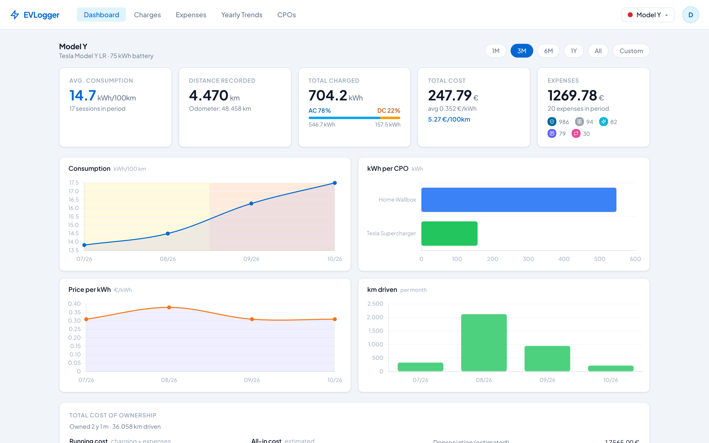
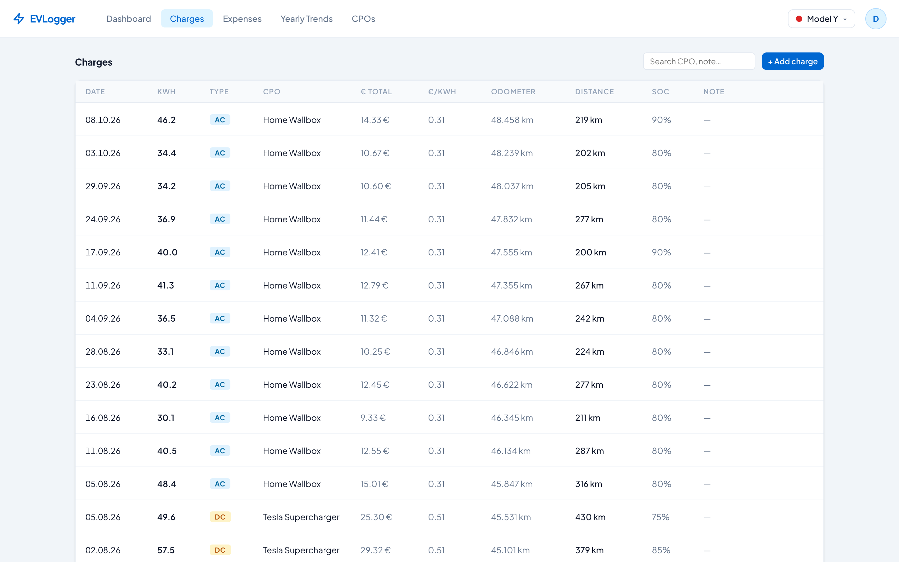
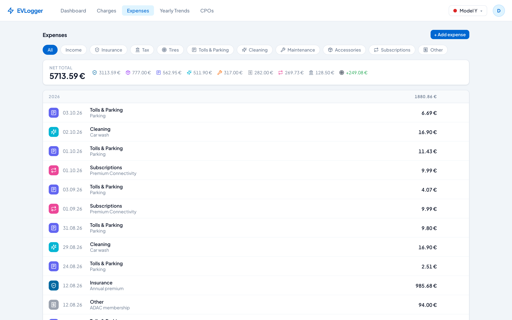
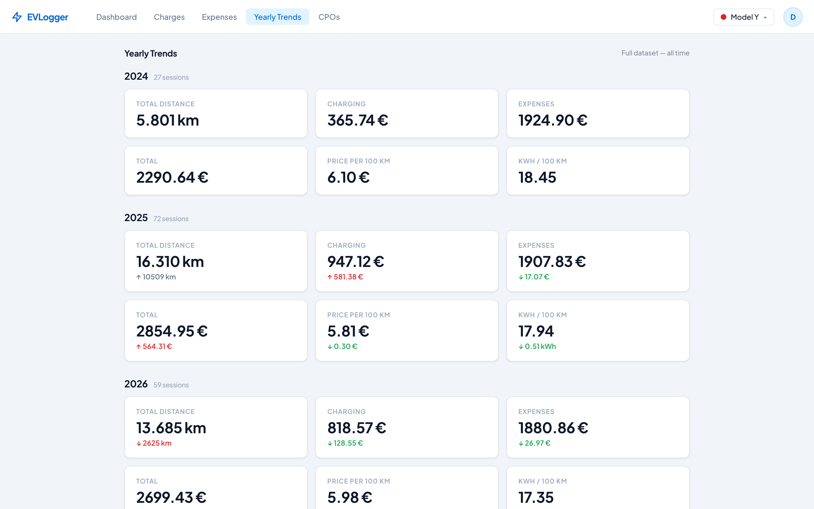
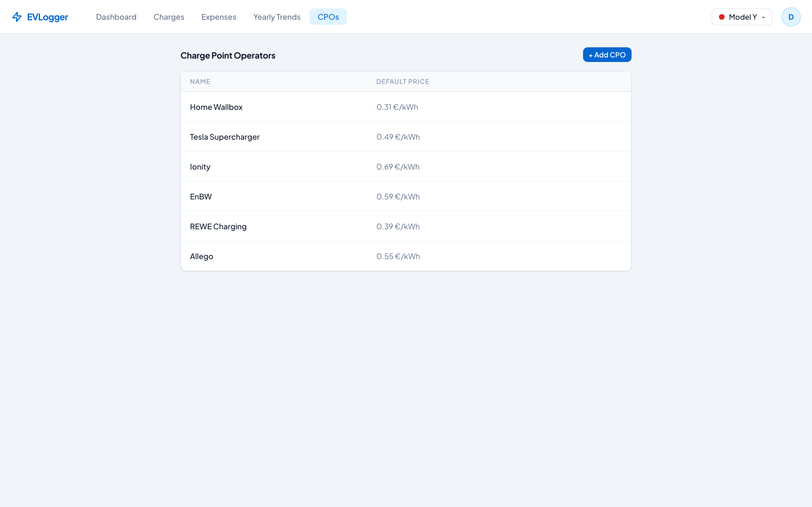
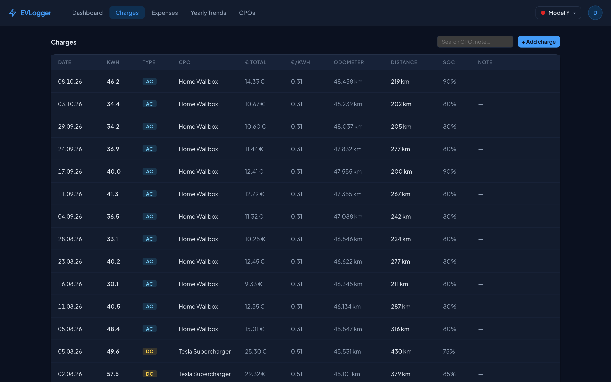
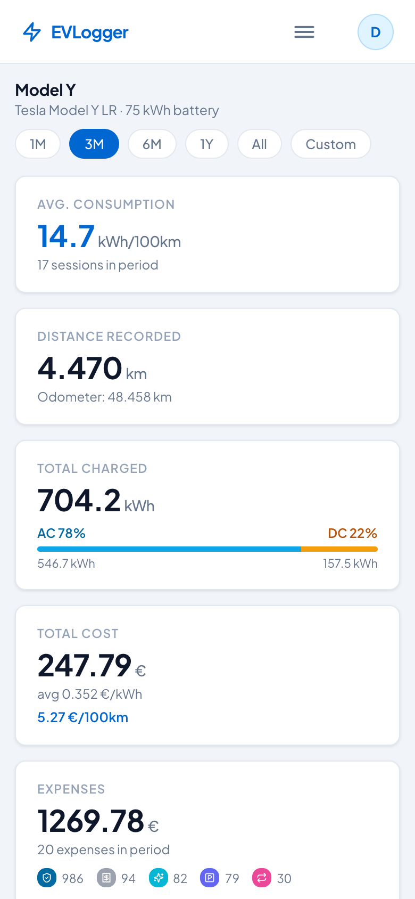
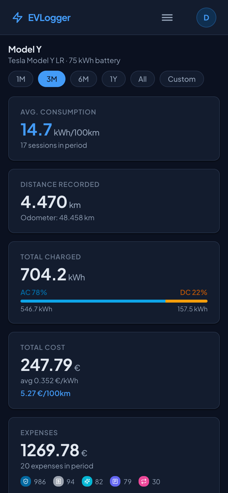

<h1 align="center">⚡ EVLogger</h1>

<p align="center">
  Self-hosted tracker for EV charging sessions and the full cost of owning your cars.
</p>

> [!WARNING]
> **This is a purely vibecoded project.** Nearly all of the code was written by AI coding
> assistants, with a human steering and testing it for personal use. It works for its author,
> but it has not been audited or reviewed line by line. Expect rough edges, read the code
> before you trust it with anything important, and don't expose it to the internet without
> putting it behind your own authentication or a VPN.

<p align="center">
  <picture>
    <source media="(prefers-color-scheme: dark)" srcset="docs/screenshots/dashboard-dark.png">
    
  </picture>
</p>

EVLogger records every charge (when, where, how much energy, what it cost) along with all other
car expenses, and turns that into statistics on your charging habits and total cost of ownership.

## Features

- **Multi-car**: separate history, stats and cost of ownership for each vehicle.
- **Charge records**: date, odometer, kWh, total cost, AC/DC, state of charge, notes.
- **Charge Point Operators (CPOs)**: store charger networks with a default per-kWh price,
  so a charge without a price gets one filled in.
- **Expenses and income**: insurance, tax, tires, tolls & parking, cleaning, maintenance,
  accessories, subscriptions; income (sold parts, refunds) reduces your cost.
- **Total cost of ownership**: purchase and sale price per car, running and all-in cost
  per 100 km, retire sold cars.
- **Statistics**: dashboard over any time range, plus year-over-year trends.
- **CSV import**: bring your existing charging spreadsheet.
- **Multi-user**: everyone sees only their own data; the first registered user becomes admin.
- **API tokens**: long-lived personal tokens (`clk_…`) for scripts and integrations.
- **Responsive**: the same UI works on a phone.
- **Dark mode**: follows your system, or pick light/dark in the user menu.
- **Demo mode**: optional "Try demo" button that runs entirely in the browser with fake data.

## Screenshots

| Charges | Expenses |
|---|---|
|  |  |
| **Yearly trends** | **Charge Point Operators** |
|  |  |

| **Dark mode** | **On a phone** |
|---|---|
|  |   |

<sub>All screenshots show the built-in demo data.</sub>

## Quick start (Docker Compose)

```bash
git clone https://github.com/ict/evlogger.git && cd evlogger
echo "API_SECRET_KEY=$(openssl rand -hex 32)" > .env
docker compose up -d
```

Then open http://localhost:8080, register an account (the first one becomes admin), add a car
and at least one CPO (e.g. your home wallbox), and start logging charges or import a CSV.

`API_SECRET_KEY` signs login tokens. Compose refuses to start without it, and the backend
rejects known example keys and keys shorter than 32 characters.

| Service        | URL                            | Notes                                          |
|----------------|--------------------------------|------------------------------------------------|
| Frontend + API | http://localhost:8080          | Caddy serves the SPA and proxies `/api/*`      |
| API docs       | http://localhost:8080/api/docs | Swagger UI                                     |
| MongoDB        | localhost:27017                | Published for development; drop the port mapping in production |

## Configuration

### Backend

| Variable                          | Default                              | Description                    |
|-----------------------------------|--------------------------------------|--------------------------------|
| `MONGODB_URL`                     | `mongodb://mongo:27017/chargelogger` | MongoDB connection string      |
| `API_SECRET_KEY`                  | *(must be set)*                      | JWT signing secret, ≥ 32 chars |
| `API_ALGORITHM`                   | `HS256`                              | JWT algorithm                  |
| `API_ACCESS_TOKEN_EXPIRE_MINUTES` | `129600` (90 days)                   | Login token lifetime           |
| `API_ROOT_PATH`                   | `/api` in compose                    | Path prefix behind the proxy   |

### Frontend

The frontend is a static bundle that calls the API at the relative path `/api`.

| Variable            | Default | Description                                                    |
|---------------------|---------|----------------------------------------------------------------|
| `VITE_DEMO_ENABLED` | `false` | Show the "Try demo" button. Set in `frontend/.env.local` for dev or at build time. |

## API and integrations

Everything the UI does goes through a REST API (FastAPI, docs at `/api/docs`). Create a
personal token under **user menu → API tokens** and send it as `Authorization: Bearer clk_…`.

- `GET /charge/stats?from_date=…&to_date=…` returns count, kWh and cost in total and per car,
  handy for dashboards.
- [**ha-chargelogger**](https://github.com/ict/ha-chargelogger) is a Home Assistant integration
  with monthly charging sensors and one-tap expense buttons (e.g. "car wash").

## Development

```
evlogger/
├── backend/          # FastAPI + Motor (MongoDB) API, see backend/README.md
├── frontend/         # React (Vite) SPA, see frontend/README.md
├── docs/screenshots/ # images for this README
└── docker-compose.yml
```

Backend tooling uses [mise](https://mise.jdx.dev) and [uv](https://docs.astral.sh/uv/):

```bash
cd backend
uv sync
mise run test     # pytest with an in-memory MongoDB, no external DB needed
mise run lint     # ruff
```

Frontend:

```bash
cd frontend
npm install
VITE_DEMO_ENABLED=true npm run dev   # try the UI without a backend
```

## License

[MIT](LICENSE)
